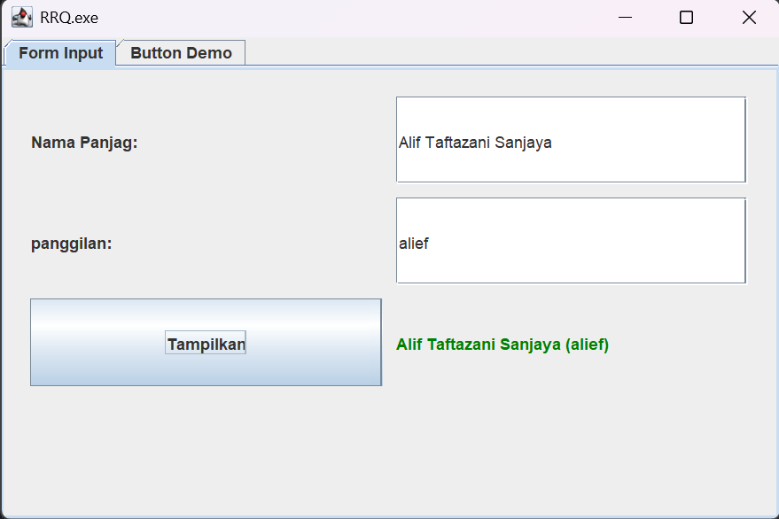
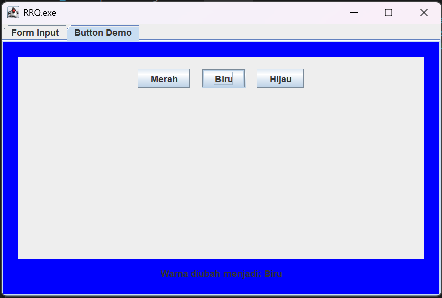

# Eksplorasi GUI Java - Alif Taftazani Sanjaya F!D02410001

1. Top-level Container Class
2. Intermediate Container Class
3. Atomic Component Class
4. Layout Classes (minimal 2)
5. Event Listener (Interface & Adapter Class)

## 5 Komponen Utama GUI yang Digunakan

### 1. Toplevel Container Class
**`JFrame`** - jendela utama aplikasi. Tidak bisa diletakkan di dalam container lain.
Digunakan di `main.java`.

### 2. Intermediate Container Class
- **`JPanel`** - panel untuk mengelompokkan komponen (`PanelForm`, `PanelButton`).
- **`JTabbedPane`** - container bertab untuk memisahkan dua demo panel.

### 3. Atomic Component Class
- **`JLabel`** - menampilkan teks / status.
- **`JTextField`** - input teks (nama panjang & panggilan).
- **`JButton`** - tombol yang bisa diklik.

### 4. Layout Classes (3 jenis)
- **`GridLayout`** - menyusun komponen dalam grid baris-kolom (digunakan di `PanelForm`).
- **`BorderLayout`** - membagi area NORTH/SOUTH/EAST/WEST/CENTER (digunakan di `PanelButton`).
- **`FlowLayout`** - menyusun komponen berurutan (di dalam `PanelButton`).

### 5. Event Listener
- **`ActionListener`** - interface yang di-override method `actionPerformed()`
  untuk menangani klik tombol (`PanelForm` & `PanelButton`).
- **`MouseAdapter`** - **Event Adapter Class** yang di-override method
  `mouseEntered()` untuk mengubah cursor saat hover tombol.

## Screenshot

### Tampilan Form Input

### Tampilan Button Demo
